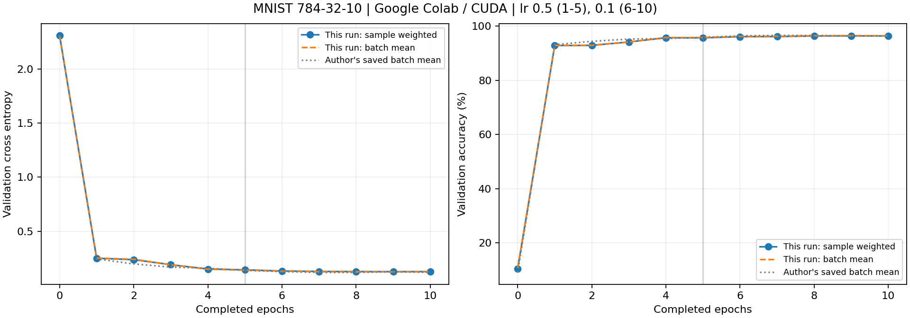

# 完整的动手指南，可在Google Colab GPU上训练你的神经网络模型

這是依參考文章的實驗設定，使用 Google Colab GPU 與 PyTorch 獨立實作的 MNIST 手寫數字分類專案。重點是看懂資料如何進入神經網路、參數如何更新，以及驗證結果如何計算，再把本次執行與原作者的輸出分開比較。

**本次實驗（2026-11-01 02:15，Asia/Taipei）已在 Google Colab Tesla T4 GPU 完成 10 epochs 訓練與評估。測試集正確率為 96.68%（9,668／10,000）。** 實際輸出已保存在 [執行版 notebook](notebooks/mnist_colab_executed.ipynb) 與 `results/`；下文將本次實跑與原作者基準分開比較。

## 檔案與上傳方式

```text
.
├── README.md
├── train.py                         # 雲端訓練與結果輸出
├── build_notebook.py                # 由 train.py 建立自含程式的 notebook 範本
├── requirements.txt                 # 選用：依本次 Colab 版本整理的相依套件參考
├── requirements-notebook.txt        # 選用：另加 nbformat 供 notebook 格式檢查
├── notebooks/
│   ├── mnist_colab.ipynb            # 可單獨上傳 Colab 的完整範本
│   └── mnist_colab_executed.ipynb   # 從 Colab 保存、含實際輸出的版本
├── docs/
│   └── reference-comparison.md      # 原作者逐 epoch 數值與比較限制
├── tests/                          # 小型程式驗證
└── results/                        # 指標、圖表與執行環境記錄
```

在 GitHub 建立 repository，選擇 **Add file → Upload files**，上傳本資料夾內的專案檔案與子資料夾，保留上述路徑；`README.md` 應位於 repository 根目錄。請一併上傳 notebook、程式、說明與結果，讓讀者能對照與重跑。

MNIST 資料會在執行時下載。`data/`、虛擬環境與模型權重不必上傳；`.gitignore` 已提供使用 Git 時的排除規則，透過網頁選檔時仍須自行略過這些項目。

## 在 Google Colab 執行

1. 開啟 [Google Colab](https://colab.research.google.com/)，選擇 **File → Upload notebook**，上傳 `notebooks/mnist_colab.ipynb`。此 notebook 自含所需程式，不需要先 clone repository。
2. 選擇 **Runtime → Change runtime type**，將硬體加速器設為 GPU；若無 GPU，可改用 CPU。GPU 類型與可用時間由 Colab 分配，資源並不保證，詳見 [Colab 官方 FAQ](https://research.google.com/colaboratory/faq.html)。
3. 選擇 **Runtime → Run all**，完成資料下載、訓練、驗證、測試與繪圖。執行前會顯示 PyTorch 版本與實際使用裝置，請保留這些輸出作為環境證據。
4. 執行最後的匯出儲存格，再點選輸出的 **下載實驗結果 ZIP** 連結，下載 `mnist_colab_results.zip`。
5. 選擇 **File → Download → Download .ipynb**，將含本次輸出的 notebook 保存為 `notebooks/mnist_colab_executed.ipynb`，再將需要公開的結果加入 GitHub。

Colab 直接使用雲端環境預載、彼此相容的 PyTorch／Torchvision，不執行會覆蓋 CUDA 套件的安裝指令。`requirements.txt` 依本次使用的主要套件版本整理，供其他開發環境選用；實際 CUDA build、版本與 GPU 型號以 `environment.json` 為準。

Colab 執行環境的檔案不會隨 notebook 自動分享；請在工作階段結束前下載結果。這也與 [Colab 的檔案分享說明](https://research.google.com/colaboratory/faq.html)一致。

修改 `train.py` 後，可用 `python build_notebook.py` 重新建立未執行的 Colab 範本。已具備相依套件的開發環境可選擇執行 `python -m unittest discover -s tests -v` 驗證原始碼；這項檢查與 Colab 的完整訓練成果分開記錄。

## 實驗設定

| 項目 | 本專案預設 |
|---|---|
| 資料 | MNIST：訓練 50,000、驗證 10,000、官方測試集 10,000 |
| 前處理 | `ToTensor()` 將像素縮放至 0–1；不額外做均值／標準差正規化 |
| 網路 | 28×28 攤平成 784 → Linear(784, 32) → ReLU → Linear(32, 10) |
| 參數數量 | 25,450 |
| 損失與更新 | CrossEntropyLoss、SGD，無 momentum 與 weight decay |
| 訓練排程 | 學習率 0.5 訓練 5 epochs，再以同一模型、學習率 0.1 續訓 5 epochs |
| 批次大小 | 訓練 128；驗證與測試 256 |
| 重現設定 | 隨機種子 42；驗證與測試不打亂；`num_workers=0` |

原作者沒有固定種子與完整環境版本，因此相同設定不代表會得到逐位一致的數字。CPU 與 GPU 的運算差異也可能影響結果；請連同 `environment.json` 一起閱讀。

## 結果是怎麼算出來的？

對一張攤平的影像 (x)，模型先算隱藏層，再輸出 10 個類別的分數：

```text
h = ReLU(W1 x + b1)
z = W2 h + b2
預測數字 = argmax(z)
```

`z` 是 logits，尚未轉成機率。`CrossEntropyLoss` 直接接收 logits 與正確類別 `y`，計算負對數機率；不必在模型尾端再加一次 softmax。對單筆資料：

```text
L = -z[y] + log(sum(exp(z[k])))
```

每一批訓練資料依序執行 `zero_grad()` 清除舊梯度、前向傳播計算 loss、`loss.backward()` 反向傳播求梯度，再用 `optimizer.step()` 更新參數。此專案的 SGD 更新可寫成 `θ ← θ − 學習率 × ∇θ L`。公式與 API 行為可參考 [CrossEntropyLoss](https://docs.pytorch.org/docs/2.11/generated/torch.nn.CrossEntropyLoss.html)及 [SGD](https://docs.pytorch.org/docs/2.11/generated/torch.optim.SGD.html)官方文件。

驗證與測試以 `eval()`、`inference_mode()` 執行，不更新參數。令第 `i` 批的樣本數、平均 loss、正確率分別為 `n_i`、`loss_i`、`acc_i`：

```text
樣本加權 loss     = Σ(n_i × loss_i) / Σn_i
樣本加權 accuracy = 正確預測總數 / 樣本總數
原作者批次平均   = Σ(各批指標) / 批次數
```

這兩種平均方式須分開比較。10,000 筆驗證資料以 256 筆分批後，最後一批只有 16 筆；批次平均仍讓它佔 1/40，加權平均則只佔 16/10,000。專案保留兩種指標，避免把計算方式造成的差距解讀成模型進步。

## 如何讀取比較結果

原作者已儲存的最終**驗證集、批次平均**為 loss **0.1198**、accuracy **96.36%**；這是原始 notebook 的基準，不是本專案實測。初始值與各 epoch 的完整來源表，請見 [比較說明](docs/reference-comparison.md)。

本次訓練與評估均在 **Google Colab Tesla T4 GPU** 完成，結果取自 [metrics.json](results/metrics.json)：

| 來源與資料集 | 指標算法 | Loss | Accuracy |
|---|---|---:|---:|
| 原作者已儲存的驗證結果 | 批次平均 | 0.1198 | 96.36% |
| 本次 Colab 驗證結果 | 批次平均 | 0.1251 | 96.44% |
| 本次 Colab 驗證結果 | 樣本加權 | 0.1270 | 96.35% |
| 本次 Colab 測試結果 | 樣本加權 | 0.1074 | 96.68% |

以相同的批次平均方式看，本次驗證正確率比原作者約高 **0.08 個百分點**，loss 則略高。原作者未固定種子，本次另固定種子、資料切分並關閉驗證資料打亂，加上環境差異，這一次執行不足以宣稱顯著改善。測試集成績來自另一組資料，應獨立閱讀。

本次環境為 Python **3.13.16**、PyTorch **2.11.0+cu130**、Torchvision **0.26.0+cu130**、NumPy **2.1.3**、Matplotlib **3.10.0**；完整紀錄見 [environment.json](results/environment.json)。10 epochs 的訓練與逐輪驗證共 **75.4259 秒**，包含每輪 CSV 寫入，不含資料下載、初始驗證、最終測試、繪圖與最後檔案儲存。



`results/` 的輸出用途如下；實際指標以該次執行檔案為準：

| 檔案 | 用途 |
|---|---|
| `history.csv` | 初始驗證與逐 epoch 的訓練、驗證紀錄 |
| `metrics.json` | 最終驗證及測試指標 |
| `source_comparison.csv` | 本次結果與原作者基準並列 |
| `training_curves.png` | loss／accuracy 隨訓練進度變化 |
| `confusion_matrix.png`、`confusion_matrix.csv` | 測試集各數字的誤判分布與原始計數 |
| `test_predictions.csv` | 測試集逐筆標籤與預測，供核對正確率 |
| `predictions.png`、`mistakes.png` | 預測範例與錯誤案例 |
| `environment.json` | Python、套件、裝置與 GPU 資訊；種子記錄於 `metrics.json` |
| `model.pt` | Colab 執行時產生的模型權重；GitHub 不另附獨立權重檔，`.gitignore` 亦排除它；Notebook 內的結果 ZIP 連結仍可取得 |

## 參考來源

- [使用者提供的中文參考文章](https://zhuanlan.zhihu.com/p/379291795)。
- [原始英文教學：在 Google Colab GPU 訓練神經網路](https://www.analyticsvidhya.com/blog/2021/05/a-complete-hands-on-guide-to-train-your-neural-network-model-on-google-colab-gpu/)。
- [原作者 notebook 固定版本與已儲存輸出](https://github.com/radathan1/Running-Deep-Learning-Model-on-GPU/blob/f7b4405ad1bfcfcc994f00a964904d1d5e1544e7/Running_Deep_Learning_Model_on_GPU%20%281%29.ipynb)。

本專案的程式與說明為獨立實作；原作者數值僅作為有來源標示的實驗比較。
