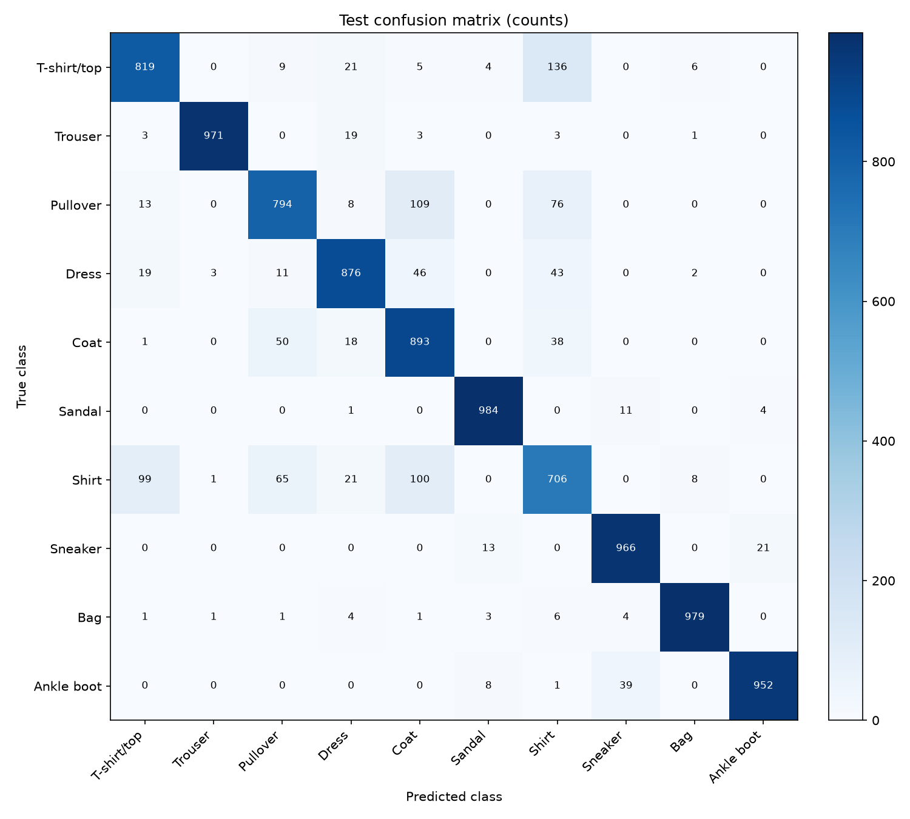
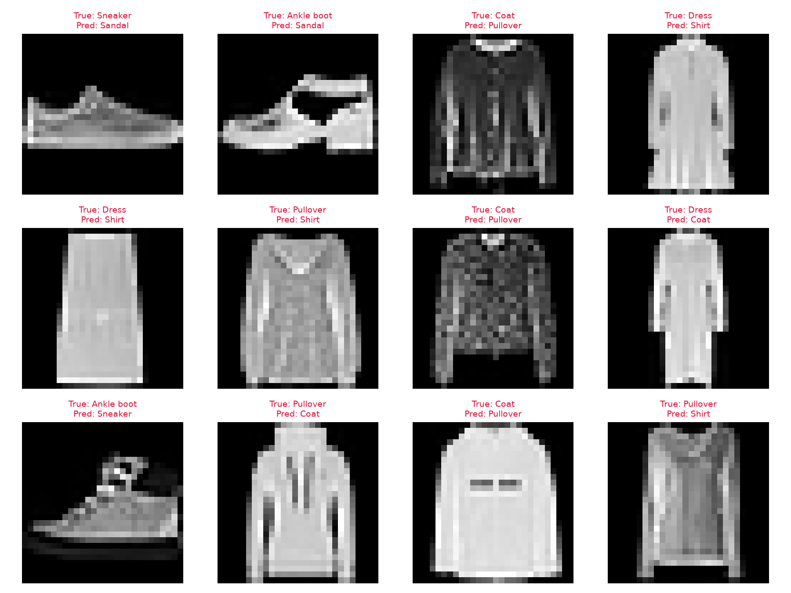

# 完整的動手指南：可在 Google Colab GPU 上訓練你的神經網路模型

## 摘要

本報告建立一套可在 Google Colab GPU 執行的神經網路訓練流程，以 Python、PyTorch 與 Fashion-MNIST 服飾影像分類為實作範例。流程涵蓋運算裝置確認、資料切分、影像前處理、CNN 建模、參數最佳化、驗證模型選擇、最終測試、錯誤分析，以及模型與實驗紀錄保存。

為避免訓練與評估混淆，將官方 60,000 張訓練資料分為 54,000 張訓練集與 6,000 張驗證集，官方 10,000 張測試資料保留至模型選定後使用。以驗證 loss 最低的權重作為最終模型，並輸出學習曲線、混淆矩陣與預測影像。

實驗於 2026 年 10 月 29 日在本機 Windows 筆電的 NVIDIA GeForce RTX 4060 Laptop GPU 完成，使用完整資料訓練 5 輪。最佳驗證模型位於第 5 輪，測試準確率為 **89.40%**、Macro F1 為 **0.894313**，訓練與驗證計時 **48.91 秒**。報告保留 Colab 操作指南，但雲端 Colab 環境尚未另行實測；本文的 GPU 指標與圖表均來自這台筆電。

## 一、研究動機與目標

神經網路訓練不只有建立模型，還包括準備資料、確認運算裝置、選擇評估方式及保存實驗證據。初學者即使成功執行程式，也可能不知道是否真正使用 GPU，或將訓練資料的高準確率誤認為模型的泛化能力。

Google Colab 提供瀏覽器中的筆記本環境，可使用包含 GPU 在內的運算資源，適合作為入門操作平台；但硬體與資源額度並不保證，因此實驗仍需記錄實際環境與保存成果。[Colab 官方 FAQ](https://research.google.com/colaboratory/intl/en-GB/faq.html)

本報告的目標是：

1. 建立可從頭依序執行的 Colab 筆記本。
2. 說明 CNN 的輸入、特徵擷取與分類流程。
3. 正確區分訓練、驗證及測試資料。
4. 產出能追溯設定與環境的實驗結果。
5. 以 GitHub 整理程式、教學與報告，方便他人閱讀與重做。

## 二、背景原理

### 2.1 神經網路與 CNN

神經網路由帶有可訓練參數的層組成，透過連續轉換將輸入映射到輸出。對影像分類而言，輸入是像素，輸出是各類別分數。CNN 的卷積層使用共享的濾波器處理局部區域，逐層建立特徵表示；ReLU 讓模型能表達非線性關係，池化則縮小特徵圖。

本模型以兩層卷積擷取影像特徵，再用全連接層輸出 10 類 logits。Dropout 在訓練期間隨機遮蔽部分特徵，在評估期間停用，因此訓練與推論必須切換正確模式。[PyTorch 模型與訓練入門](https://docs.pytorch.org/tutorials/beginner/basics/quickstart_tutorial.html)

### 2.2 損失函數與參數更新

模型先對每批影像產生 logits，再由交叉熵損失衡量預測與標籤之間的差異。反向傳播計算各參數對損失的梯度，Adam 根據梯度更新參數。更新前需清除先前梯度，避免無意間累積。

本專案將原始 logits 直接傳入 `CrossEntropyLoss`，不在損失函數前額外加入 Softmax。accuracy 用來衡量分類是否正確，loss 則包含預測分數與正確標籤的關係，兩者應一起觀察。[PyTorch 最佳化教學](https://docs.pytorch.org/tutorials/beginner/basics/optimization_tutorial.html)

### 2.3 訓練、驗證與測試

訓練集用來更新參數；驗證集用來選模型及觀察訓練狀態；測試集用來評估設定確定後的模型。若依測試結果持續修改設定，測試資訊便間接參與模型選擇，可能造成過度樂觀的評估。[模型評估與資料切分](https://scikit-learn.org/stable/modules/cross_validation.html)

### 2.4 GPU 運算

GPU 適合平行處理大量張量運算，但選擇 GPU 執行階段後，模型與資料仍須放到 GPU 才會實際使用它。CPU 與 GPU 的執行時間也受資料載入、傳輸、模型大小與硬體差異影響。

若進行時間比較，必須保持相同工作量並清楚界定計時範圍。由於 CUDA 運算可非同步執行，應在計時邊界等待 GPU 完成，避免測到僅將工作送出的時間。[PyTorch CUDA 語意與計時](https://docs.pytorch.org/docs/2.14/notes/cuda.html)

## 三、實作方法

### 3.1 資料集與前處理

Fashion-MNIST 包含 28×28 灰階服飾影像，官方提供 60,000 張訓練資料及 10,000 張測試資料，分類標籤共有 10 類：T-shirt/top、Trouser、Pullover、Dress、Coat、Sandal、Shirt、Sneaker、Bag、Ankle boot。[Zalando Research 原始資料集](https://github.com/zalandoresearch/fashion-mnist)

| 集合 | 張數 | 來源與用途 |
| --- | ---: | --- |
| 訓練 | 54,000 | 官方訓練資料固定切分，用於梯度更新 |
| 驗證 | 6,000 | 官方訓練資料固定切分，用於模型選擇 |
| 測試 | 10,000 | 官方測試資料，用於最終評估 |

以 seed 42 固定訓練／驗證切分。影像轉為 0～1 的張量後，使用固定轉換 `(x - 0.5) / 0.5`，不以測試資料估計統計量。三個集合使用一致的確定性前處理。若未來改為依資料計算正規化參數，只能由訓練集估計。[前處理與資料洩漏](https://scikit-learn.org/stable/common_pitfalls.html)

### 3.2 模型結構

| 層 | 輸出形狀，不含批次維度 |
| --- | --- |
| 輸入 | `1 × 28 × 28` |
| Conv2d 1→16，3×3，padding 1；ReLU | `16 × 28 × 28` |
| MaxPool2d 2×2 | `16 × 14 × 14` |
| Conv2d 16→32，3×3，padding 1；ReLU | `32 × 14 × 14` |
| MaxPool2d 2×2 | `32 × 7 × 7` |
| Flatten | `1568` |
| Linear 1568→128；ReLU；Dropout 0.2 | `128` |
| Linear 128→10 | `10` |

此模型共有 206,922 個可訓練參數。模型規模以清楚展示完整流程為考量，並未將追求最高排行榜成績作為本報告目標。

### 3.3 訓練設定與最佳模型

| 項目 | 完整模式設定 |
| --- | --- |
| epochs | 5 |
| batch size | 128 |
| optimizer | Adam |
| learning rate | 0.001 |
| loss | CrossEntropyLoss |
| seed | 42 |
| num_workers | 0 |
| checkpoint 選擇 | 驗證 loss 最低 |

每個 epoch 先以訓練模式更新模型，再以評估模式及無梯度計算驗證指標。平均 loss 按樣本數加權，accuracy 為正確預測數除以樣本總數。完成訓練後，載入最佳驗證模型，對測試集執行一次最終評估。

除整體 accuracy 外，另記錄每類 precision（預測為該類者有多少正確）、recall（真實該類者有多少被找出）與 F1，並以 10 類 F1 的等權平均計算 Macro F1。混淆矩陣的列為真實類別、欄為預測類別，協助追查錯誤分布。

為協助初次執行，另提供 quick 模式：2,048 張訓練、512 張驗證、512 張測試，訓練 1 個 epoch。此模式僅確認程式流程，不能代表完整資料實驗的表現。

### 3.4 成果保存與重現

每次執行保存設定、環境、每個 epoch 的紀錄、最終指標、最佳權重及圖表。筆記本提供 Drive 輸出與 ZIP 下載方式，避免虛擬機器結束後失去成果。[Colab 檔案與執行環境說明](https://research.google.com/colaboratory/intl/en-GB/faq.html)

固定 seed 有助降低隨機差異，但不保證跨 PyTorch 版本或硬體完全重現，因此報告須附上實際環境資訊。[PyTorch 重現性](https://docs.pytorch.org/docs/2.14/notes/randomness.html)

## 四、實驗結果

### 4.1 實際執行環境

本次使用本機 RTX 4060 Laptop GPU，實際裝置為 `cuda`，並確認 CUDA 張量運算成功。訓練核心為 `src.training.run_experiment`；另保存硬體資訊與 PyTorch 顯示記憶體配置峰值，不以「電腦配有 GPU」代替運算裝置的確認。

| 項目 | 實際環境 |
| --- | --- |
| 日期／時間 | 2026-10-29，約 08:38，Asia/Taipei |
| 執行位置／系統 | 本機筆電／Windows 11 |
| GPU | NVIDIA GeForce RTX 4060 Laptop GPU |
| GPU 記憶體／驅動程式 | 硬體回報 8,188 MiB／610.74 |
| Python | 3.12.14 |
| PyTorch／torchvision | 2.9.1+cu128／0.24.1+cu128 |
| CUDA runtime／NumPy | 12.8／2.5.4 |
| PyTorch CPU 運算執行緒 | 4 |
| 模式 | 完整資料，quick_mode = false |

證據為 [environment.json](../results/local_rtx4060/environment.json)、[gpu_hardware.json](../results/local_rtx4060/gpu_hardware.json) 與 [gpu_runtime.json](../results/local_rtx4060/gpu_runtime.json)。

### 4.2 整體分類結果

| 指標 | 實測值 |
| --- | ---: |
| 訓練／驗證／測試張數 | 54,000／6,000／10,000 |
| 最佳 epoch | 5 |
| 最低驗證 loss | 0.279371 |
| 最佳 epoch 的驗證 accuracy | 89.57% |
| 最終測試 loss | 0.289209 |
| 最終測試 accuracy | **89.40%** |
| 正確／錯誤張數 | 8,940／1,060 |
| Macro F1 | 0.894313 |
| 訓練與驗證計時 | 48.91 秒 |
| 外層記錄的整個實驗呼叫 | 51.63 秒 |
| 可訓練參數 | 206,922 |

`train_seconds` 的 48.91 秒包含 5 輪訓練、驗證、checkpoint 及歷史紀錄寫入，不包含最終測試與圖表產生。51.63 秒是外層記錄的整個實驗函式呼叫時間，兩者範圍不同；套件安裝與首次資料下載亦不能算入前者。本次使用已快取的資料。

PyTorch 記錄的最高張量配置量約 41.86 MiB，最高保留量為 68.00 MiB。這是 PyTorch 記憶體配置器的統計，未涵蓋整張顯示卡的驅動、其他程式與所有 CUDA 開銷，不能當成整機 GPU 記憶體占用。完整數字見 [GPU 執行紀錄](../results/local_rtx4060/gpu_runtime.json)。

### 4.3 學習曲線

| Epoch | 訓練 loss | 訓練 accuracy | 驗證 loss | 驗證 accuracy |
| --- | ---: | ---: | ---: | ---: |
| 1 | 0.574962 | 79.15% | 0.383078 | 85.93% |
| 2 | 0.365871 | 86.86% | 0.324046 | 88.10% |
| 3 | 0.319999 | 88.37% | 0.304462 | 88.68% |
| 4 | 0.287267 | 89.54% | 0.286214 | 89.38% |
| 5 | 0.266514 | 90.31% | 0.279371 | 89.57% |

訓練與驗證 loss 在本次五輪均持續下降，驗證 accuracy 從 85.93% 提高至 89.57%。最低驗證 loss 位於第 5 輪，符合本專案的 checkpoint 選擇規則；最終測試由該模型取得。逐輪原始數字見 [history.csv](../results/local_rtx4060/history.csv)。

### 4.4 各類別與混淆矩陣

每個測試類別各有 1,000 張影像。下表依 [metrics.json](../results/local_rtx4060/metrics.json) 整理，precision 與 recall 顯示為百分比：

| 類別 | Precision | Recall | F1 |
| --- | ---: | ---: | ---: |
| T-shirt/top | 85.76% | 81.90% | 0.8379 |
| Trouser | 99.49% | 97.10% | 0.9828 |
| Pullover | 85.38% | 79.40% | 0.8228 |
| Dress | 90.50% | 87.60% | 0.8902 |
| Coat | 77.18% | 89.30% | 0.8280 |
| Sandal | 97.23% | 98.40% | 0.9781 |
| Shirt | 69.97% | 70.60% | 0.7028 |
| Sneaker | 94.71% | 96.60% | 0.9564 |
| Bag | 98.29% | 97.90% | 0.9810 |
| Ankle boot | 97.44% | 95.20% | 0.9631 |

縱軸為真實類別，橫軸為預測類別。較明顯的錯誤包括 136 張 T-shirt/top 被判成 Shirt、109 張 Pullover 被判成 Coat、100 張 Shirt 被判成 Coat，以及 99 張 Shirt 被判成 T-shirt/top。Shirt 召回率為 70.60%，低於本次其他類別；整體 accuracy 因而不能完整描述所有類別的表現。

### 4.5 預測與錯誤範例

錯例中可見 Coat 被判為 Pullover、Dress 被判為 Shirt、Pullover 被判為 Shirt，以及 Ankle boot 被判為 Sneaker。部分衣物具有近似的袖子與軀幹輪廓；28×28 灰階圖也缺少顏色及細節。這些是可見的影像特徵與可能解釋，尚不足以證明特定特徵就是模型判錯的因果原因。

### 4.6 先前 CPU 紀錄的定位

先前同一台電腦的 CPU 完整實驗使用 PyTorch 2.9.1+cpu、torchvision 0.24.1+cpu，測試 accuracy 為 89.57%，訓練與驗證計時 51.97 秒，詳見 [CPU 實驗摘要](../results/local_cpu_demo/summary.md)。本次 GPU 使用 CUDA 組建，軟體環境與運算後端不同，且兩者均為單次執行。這些數字可作歷史對照，不能據此宣稱純硬體加速倍數或裝置間具有穩定的準確率優劣。

## 五、討論

### 5.1 如何判斷模型是否學到有效規律

本次訓練 loss 由 0.5750 降至 0.2665，驗證 loss 也由 0.3831 降至 0.2794，表示改善不限於訓練資料。在觀察到的 5 輪中，未出現驗證 loss 反轉上升的趨勢，但這不代表更長訓練一定不會過擬合。

早期驗證 accuracy 高於當輪訓練 accuracy 也不必直接視為錯誤：訓練統計是在權重持續更新、Dropout 啟用時累積；驗證則使用該輪結束後的權重與評估模式。兩者的條件不同。最終測試 accuracy 為 89.40%，與最佳 epoch 的驗證 accuracy 89.57% 接近，但單一切分不能完整量化模型的不確定性。

### 5.2 錯誤分析與模型限制

Shirt 的 precision 為 69.97%、recall 為 70.60%，兩者均較低；不只真實襯衫容易被分到其他上衣，也有其他上衣被判成襯衫。相較之下，Trouser 的 precision 為 99.49%，Sandal 的 recall 為 98.40%。這說明後續改善應關注特定類別錯誤，而不只追求整體 accuracy 上升。

Fashion-MNIST 是簡化的灰階商品影像分類任務，因此結果不能直接推論到真實相機拍攝、背景複雜、光線變化或資料分布不同的場景。

### 5.3 GPU 實作與 Colab 適用範圍

本機最初的 PyTorch 為 CPU 組建，即使 NVIDIA 驅動能辨識顯示卡，仍需安裝相容的 CUDA 組建才能讓 PyTorch 使用 GPU。本次改為 2.9.1+cu128／0.24.1+cu128 後，以實際 CUDA 張量運算及完整訓練確認裝置可用，並保留硬體、軟體與顯示記憶體配置峰值紀錄。

同一訓練核心已放入可獨立上傳的 Colab 筆記本，包含 GPU 檢查、Drive 保存與 ZIP 下載；雲端環境尚未另行執行，因此雲端硬體供應、套件版本與實際耗時仍應以使用當下為準。本次完成的是本機 GPU 實測與完整 Colab 操作指南，不將本機硬體數字標為雲端測量。

這是小型 CNN 的單次實驗，訓練時間也包含驗證與紀錄寫入。先前 CPU 與本次 GPU 的環境未完全一致，不做加速倍數推論。公平速度比較應另行控制軟體、工作量、計時範圍及重複次數，詳見 [實驗紀錄指南](EXPERIMENTS.md)。

### 5.4 後續改善

可依序比較 learning rate、epochs 或 batch size，每次只改一項，並維持相同驗證切分。先根據驗證結果選擇設定，再對最終模型評估測試集。若時間允許，可用多個訓練 seed 重複實驗，呈現變異；若只執行一次，應明示其限制。

## 六、結論

本專案完成從運算裝置確認到資料準備、CNN 訓練、驗證選擇、最終測試、模型保存與預測的完整流程，並提供可獨立使用的 Colab 筆記本。以本機 RTX 4060 Laptop GPU 執行完整資料的 5 輪實驗後，第 5 輪取得最低驗證 loss，最終測試 accuracy 為 89.40%，Macro F1 為 0.894313，訓練與驗證計時為 48.91 秒。

逐輪 loss、混淆矩陣與錯例顯示模型已學到有效的分類規律，但 Shirt 與其他上衣仍容易混淆，且此資料集無法代表真實拍照場景。成果已保存設定、環境、指標、圖表及可載入的 [最佳模型權重](../results/local_rtx4060/best_model.pt)，可追溯至 [本次 GPU 實驗摘要](../results/local_rtx4060/summary.md)。

## 參考資料

1. [Google Colab 官方 FAQ](https://research.google.com/colaboratory/intl/en-GB/faq.html)。
2. [Zalando Research：Fashion-MNIST](https://github.com/zalandoresearch/fashion-mnist)。
3. [PyTorch：Learn the Basics／Quickstart](https://docs.pytorch.org/tutorials/beginner/basics/quickstart_tutorial.html)。
4. [PyTorch：Optimizing Model Parameters](https://docs.pytorch.org/tutorials/beginner/basics/optimization_tutorial.html)。
5. [PyTorch：Saving and Loading Models](https://docs.pytorch.org/tutorials/beginner/saving_loading_models.html)。
6. [PyTorch：Reproducibility](https://docs.pytorch.org/docs/2.14/notes/randomness.html)。
7. [PyTorch：CUDA semantics](https://docs.pytorch.org/docs/2.14/notes/cuda.html)。
8. [scikit-learn：Cross-validation](https://scikit-learn.org/stable/modules/cross_validation.html)。
9. [scikit-learn：Common pitfalls and recommended practices](https://scikit-learn.org/stable/common_pitfalls.html)。
