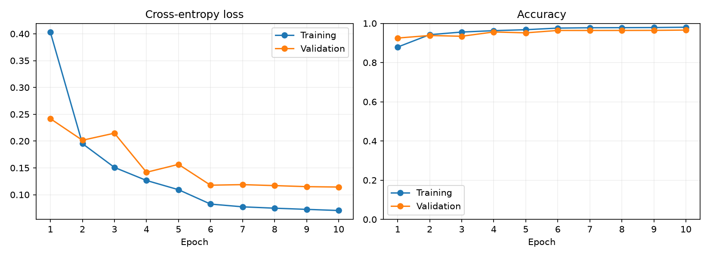
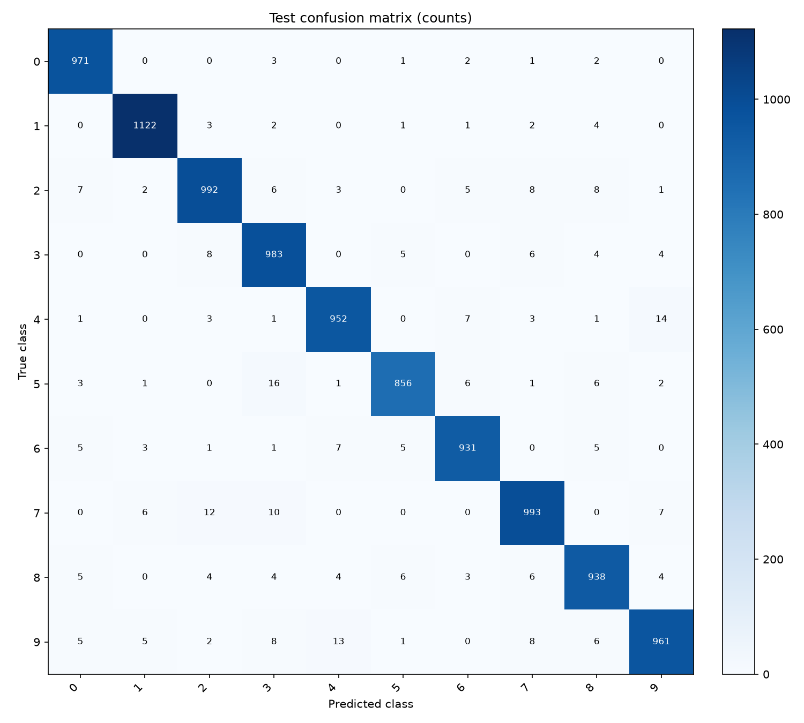
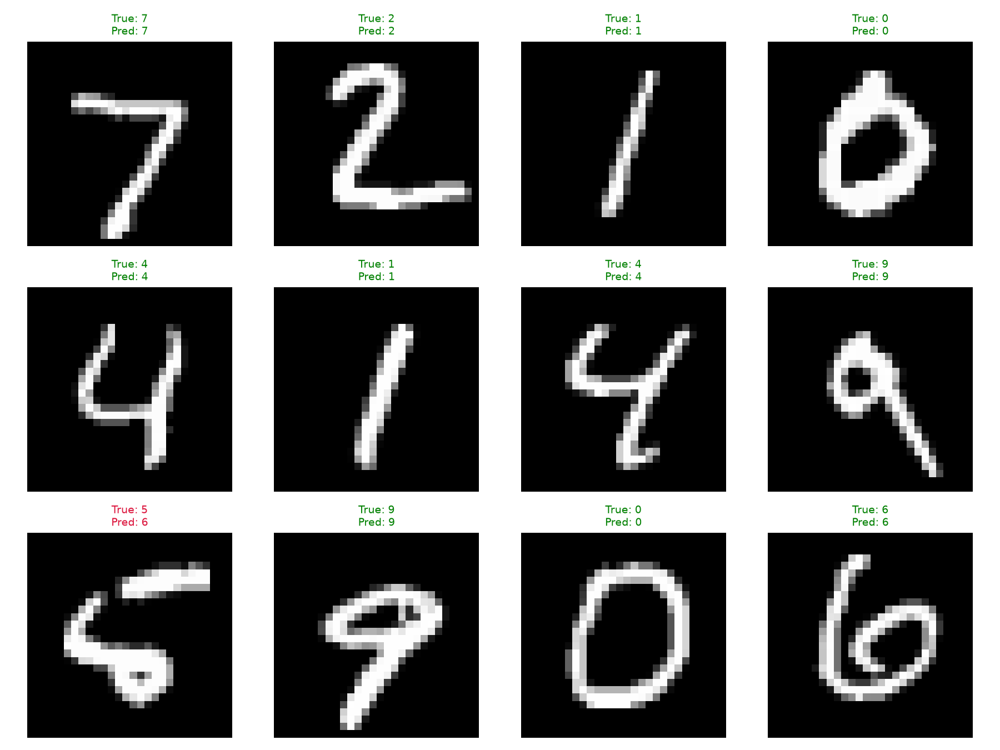
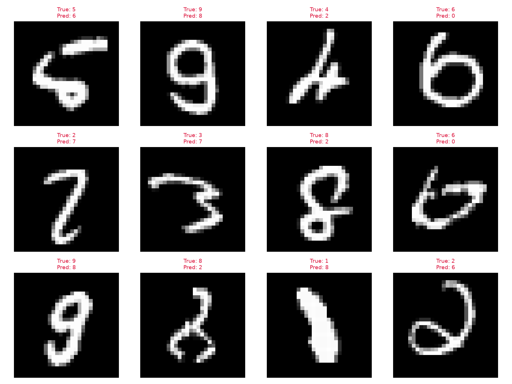

# 完整的動手指南：可在 Google Colab GPU 上訓練你的神經網路模型

## 摘要

本報告以[安大叔的指定文章](https://zhuanlan.zhihu.com/p/379291795)為主要依據，重現以 PyTorch 在 GPU 上訓練 MNIST 手寫數字模型的教學。主線保留原文 11 個步驟：設定 Colab、載入資料、建立模型、選擇裝置、搬移批次與模型，再進行訓練驗證。模型為 784→32→10 的單隱藏層網路，使用 ReLU、交叉熵及 SGD，依作者 notebook 先以 0.5 訓練 5 輪，再以 0.1 續訓 5 輪。

實驗將官方訓練資料切為 50,000 張訓練及 10,000 張驗證，另保留官方 10,000 張測試資料。本報告修正展示程式的排版與指標彙總問題，新增固定 seed、最佳驗證權重、獨立測試及可追溯成果。2026 年 10 月 29 日於本機 RTX 4060 Laptop GPU 完成 10 輪訓練，最佳驗證模型位於第 10 輪，獨立測試 accuracy 為 **96.99%**、Macro F1 為 **0.969714**，訓練與驗證計時 **43.48 秒**。Colab 雲端尚未另行實測，本文數字與圖表均來自這台筆電。

## 一、動機與研究目標

神經網路訓練會反覆執行矩陣與張量運算。GPU 能平行處理大量相似工作，支援這類計算；CPU 仍負責程式控制及資料準備。對初學者而言，重要的不只是啟用硬體加速器，而是確認模型、輸入及標籤都位於正確裝置。這是[指定文章](https://zhuanlan.zhihu.com/p/379291795)從 GPU 概念帶入實作的重點。

本報告的目標為：

1. 依原文 11 步整理可獨立上傳 Colab 的筆記本。
2. 說明 GPU 選擇、張量搬移及 DeviceDataLoader 的作用。
3. 實作 MNIST 單隱藏層模型與兩階段 SGD 訓練。
4. 用本機 RTX 4060 的實際 GPU 執行留下設定、環境、模型與指標。
5. 區分原文內容、必要修正及新增的實驗補強。

## 二、文章核心與原理

### 2.1 GPU 的角色

原文以神經網路訓練成本說明平行運算的用途，再強調啟用 GPU、選擇裝置及搬移資料／模型。引言中的 VGG16 是運算需求例子，實際示範模型是全連接網路。

本專案使用 `torch.cuda.is_available()` 檢查 CUDA，透過 `get_default_device` 選 GPU 或 CPU。新增的 require-GPU 選項在無 GPU 時停止，防止將 CPU 執行誤標為 GPU。模型與資料須放在同一裝置；單純選取 Colab GPU 選單不能完成這些搬移。[英文原文](https://www.analyticsvidhya.com/blog/2021/05/a-complete-hands-on-guide-to-train-your-neural-network-model-on-google-colab-gpu/)

### 2.2 MNIST 與分類任務

MNIST 是 28×28 灰階手寫數字影像，標籤為 0～9。本報告沿用原文 `ToTensor()`，將像素轉為 0～1 的張量，不加入額外 Normalize。`train=True` 載入官方訓練資料，`train=False` 載入獨立測試資料。[torchvision MNIST 官方說明](https://docs.pytorch.org/vision/stable/generated/torchvision.datasets.MNIST.html)

訓練資料用於更新參數，驗證資料用於觀察及模型選擇，測試資料則在模型選定後評估。獨立測試是本報告新增的實驗補強，不被描述為原文原有結果。

### 2.3 單隱藏層神經網路

每張影像展平成 784 個數值，輸入全連接層得到 32 個隱藏特徵，經 ReLU 後，再輸出 10 個類別 logits。ReLU 提供非線性，使模型不只是多個線性轉換的組合。

| 層 | 輸出形狀，不含批次 |
| --- | --- |
| 輸入 | `1 × 28 × 28` |
| 展平 | `784` |
| Linear 784→32 | `32` |
| ReLU | `32` |
| Linear 32→10 | `10` |

參數數量為 `(784×32+32)+(32×10+10)=25,450`。模型沒有卷積、池化或 Dropout，維持原文單隱藏層的範圍。

### 2.4 交叉熵、反向傳播與 SGD

模型直接將 logits 交給交叉熵，損失計算前不額外套用 Softmax。反向傳播取得損失對參數的梯度，SGD 依學習率更新參數，每次更新清除梯度。accuracy 則是正確預測數除以樣本數，和 loss 一起描述學習情況。[PyTorch 官方最佳化教學](https://docs.pytorch.org/tutorials/beginner/basics/optimization_tutorial.html)

作者 notebook 先進行 5 輪、learning rate 0.5，再對同一模型續訓 5 輪、learning rate 0.1。每次 fit 重新建立無 momentum 的 SGD，本報告保留此兩階段設定。[作者 notebook，程式儲存格 33、34](https://github.com/radathan1/Running-Deep-Learning-Model-on-GPU/blob/main/Running_Deep_Learning_Model_on_GPU%20%281%29.ipynb)

## 三、依原文實作的方法

### 3.1 十一步流程

| 步驟 | 本專案實作 |
| --- | --- |
| 1 | 上傳筆記本，選擇 Colab GPU 執行階段。 |
| 2 | 載入 PyTorch 等套件，顯示環境。 |
| 3 | MNIST ToTensor，切分訓練／驗證。 |
| 4 | 訓練 batch 128、驗證 batch 256。 |
| 5 | 建立 784→32→10 的 MnistModel。 |
| 6 | get_default_device 選 GPU 或 CPU。 |
| 7 | to_device 搬移資料及模型。 |
| 8 | DeviceDataLoader 逐批搬到裝置。 |
| 9 | 定義 SGD 訓練與驗證。 |
| 10 | 建立模型實例，搬到相同裝置。 |
| 11 | 先觀察初始驗證，再完成兩階段 10 輪訓練。 |

逐步來源與程式位置見 [SOURCE_ALIGNMENT.md](SOURCE_ALIGNMENT.md)。獨立筆記本與本機入口使用相同訓練核心，減少兩份邏輯不一致的風險。

### 3.2 資料與設定

| 項目 | 設定 |
| --- | --- |
| 訓練／驗證／測試 | 50,000／10,000／10,000 |
| 前處理 | 僅 ToTensor，0～1 |
| train／validation與test batch | 128／256 |
| 模型／隱藏特徵 | MLP／32 |
| optimizer | SGD，無 momentum |
| learning rate | 第 1～5 輪 0.5，第 6～10 輪 0.1 |
| seed／num_workers | 42／0（Windows） |
| 最佳權重 | 驗證 loss 最低 |

### 3.3 修正與補強

原展示程式的括號、類別名稱及縮排問題依可執行語法修復，accuracy 計算也完整定義。訓練使用 `model.train()`，評估使用 `model.eval()` 與無梯度範圍。驗證 loss 按樣本數加權，accuracy 累計總正確數，避免最後的小批次被等權平均。

本報告另加入 seed 42、初始驗證紀錄、最佳驗證 checkpoint、獨立測試、混淆矩陣、每類指標、錯例與環境保存。原作者未使用這些補強來產生本文的實驗結論，因此結果需由本次執行獨立取得。

### 3.4 Colab 時效與保存

原文的 K80 與使用時間說明是當年的環境背景。現行 Colab 資源、GPU 型號及額度並不固定，需檢查當次實際裝置。暫存虛擬機器會被回收，因此筆記本提供 Drive 與 ZIP 保存流程。[Colab 官方 FAQ](https://research.google.com/colaboratory/intl/en-GB/faq.html)

## 四、MNIST GPU 實驗結果

### 4.1 環境與 GPU 執行證據

本次實際以 `src.training.run_experiment` 函式執行完整實驗，另記錄硬體、計時及 PyTorch 記憶體峰值。CUDA 張量運算已驗證成功，訓練裝置記錄為 `cuda`。

| 項目 | 實際內容 |
| --- | --- |
| 日期／時間 | 2026-10-29，13:35～13:36，Asia/Taipei |
| 執行位置／系統 | 本機筆電／Windows 11 |
| GPU | NVIDIA GeForce RTX 4060 Laptop GPU |
| GPU 記憶體／驅動 | 硬體回報 8,188 MiB／610.74 |
| Python | 3.12.14 |
| PyTorch／torchvision | 2.9.1+cu128／0.24.1+cu128 |
| CUDA runtime／NumPy | 12.8／2.5.4 |
| CPU 運算執行緒／workers | 4／0 |
| 模式 | 完整資料，quick_mode = false |

原始證據見 [environment.json](../results/mnist_rtx4060/environment.json)、[gpu_hardware.json](../results/mnist_rtx4060/gpu_hardware.json) 與 [gpu_runtime.json](../results/mnist_rtx4060/gpu_runtime.json)。

### 4.2 初始驗證與最終測試

| 指標 | 實測值 |
| --- | ---: |
| 未訓練模型驗證 loss／accuracy | 2.310835／9.86% |
| 最佳驗證 epoch | 10 |
| 最低驗證 loss | 0.114256 |
| 最佳 epoch 的驗證 accuracy | 96.57% |
| 最終測試 loss | 0.100092 |
| 最終測試 accuracy | **96.99%** |
| 測試正確／錯誤張數 | 9,699／301 |
| Macro F1 | 0.969714 |
| 可訓練參數 | 25,450 |
| 訓練與驗證計時 | 43.48 秒 |
| 外層完整實驗呼叫 | 65.93 秒 |

初始驗證保存於 [initial_validation.json](../results/mnist_rtx4060/initial_validation.json)，最終數字保存於 [metrics.json](../results/mnist_rtx4060/metrics.json)。初始與訓練後的驗證 accuracy 從 9.86% 提升至 96.57%；測試 accuracy 96.99% 使用另一個獨立集合，不能與初始驗證當成同一資料上的測量。

43.48 秒包含 fit 中的訓練、驗證、checkpoint 與歷史紀錄寫入，不包含最終測試及圖表。65.93 秒是外層完整實驗呼叫，範圍包含本次資料下載、初始驗證、訓練、最終測試與圖表，不包含套件安裝。兩個時間不可混用。

PyTorch 最高張量配置量為 20,016,640 bytes，約 19.09 MiB；最高保留量為 24.00 MiB。這是 PyTorch 配置器的記憶體統計，不等於整張 GPU 的占用，也不是 GPU 利用率。

### 4.3 十輪學習紀錄

| Epoch | Learning rate | 訓練 loss | 訓練 accuracy | 驗證 loss | 驗證 accuracy |
| --- | ---: | ---: | ---: | ---: | ---: |
| 1 | 0.5 | 0.402889 | 87.91% | 0.241746 | 92.50% |
| 2 | 0.5 | 0.195261 | 94.22% | 0.201514 | 93.80% |
| 3 | 0.5 | 0.150845 | 95.56% | 0.214684 | 93.41% |
| 4 | 0.5 | 0.126522 | 96.27% | 0.141794 | 95.60% |
| 5 | 0.5 | 0.109304 | 96.75% | 0.156530 | 95.15% |
| 6 | 0.1 | 0.082494 | 97.58% | 0.117705 | 96.38% |
| 7 | 0.1 | 0.077386 | 97.76% | 0.118750 | 96.36% |
| 8 | 0.1 | 0.074832 | 97.80% | 0.116957 | 96.38% |
| 9 | 0.1 | 0.072635 | 97.86% | 0.115005 | 96.42% |
| 10 | 0.1 | 0.070519 | 98.02% | 0.114256 | 96.57% |

原始資料見 [history.csv](../results/mnist_rtx4060/history.csv)。訓練 loss 逐輪下降；驗證 loss 在第 3、5、7 輪略有反彈，顯示每輪進步並非保證。第 10 輪驗證 loss 最低，依規則保存並載入該模型，再進行最終測試。

### 4.4 各數字類別與混淆矩陣

| 數字 | 測試張數 | Precision | Recall | F1 |
| --- | ---: | ---: | ---: | ---: |
| 0 | 980 | 97.39% | 99.08% | 0.9823 |
| 1 | 1,135 | 98.51% | 98.85% | 0.9868 |
| 2 | 1,032 | 96.78% | 96.12% | 0.9645 |
| 3 | 1,010 | 95.07% | 97.33% | 0.9618 |
| 4 | 982 | 97.14% | 96.95% | 0.9704 |
| 5 | 892 | 97.83% | 95.96% | 0.9689 |
| 6 | 958 | 97.49% | 97.18% | 0.9733 |
| 7 | 1,028 | 96.60% | 96.60% | 0.9660 |
| 8 | 974 | 96.30% | 96.30% | 0.9630 |
| 9 | 1,009 | 96.78% | 95.24% | 0.9600 |

數字 9 的 recall 為 95.24%，是本次最低值；數字 0 為 99.08%。分類錯誤中，5→3 有 16 張、4→9 有 14 張、9→4 有 13 張、7→2 有 12 張、7→3 有 10 張。這些數量由 [confusion_matrix.csv](../results/mnist_rtx4060/confusion_matrix.csv) 核對，縱軸／列為真實數字，橫軸／欄為預測數字。

### 4.5 預測、錯例與模型保存

錯例可見 5 被判為 6、9 被判為 8、6 被判為 0，以及 2 被判為 7。部分筆畫帶有封閉環或接近其他數字的輪廓；這些可見特徵是分析線索，尚不是模型判錯原因的因果證明。

已訓練的 [best_model.pt](../results/mnist_rtx4060/best_model.pt) 為第 10 輪最佳驗證 checkpoint，大小 104,413 bytes，約 0.10 MB，可配合相同模型與 ToTensor 前處理還原推論。設定、環境與指標皆保存在 [本次 GPU 成果資料夾](../results/mnist_rtx4060/summary.md)。

## 五、討論與限制

### 5.1 兩階段訓練的觀察

第一階段學習率為 0.5，訓練 loss 由 0.402889 降至 0.109304，但驗證有波動。第 6 輪改為 0.1 後，驗證 loss 從上一輪 0.156530 降為 0.117705，之後在較小範圍內變化，第 10 輪降至 0.114256。這與原作者先大步更新、後續較小步更新的流程相符。

本次只有同一模型依序訓練的觀察，沒有同時執行另一個固定學習率的受控比較，因此不能把改善全部歸因於降低學習率。也不能保證增加更多輪數會繼續提高泛化表現。

### 5.2 正確率與錯誤分析

測試 10,000 張中仍有 301 張錯誤。整體 accuracy 96.99% 概括分類表現，Macro F1 0.969714 與各數字指標則補充類別差異。測試每類張數不完全相同，因此不能把每個數字都假設成 1,000 張。

5／3、4／9、7／2 是本次明顯混淆的方向，錯例也顯示手寫筆畫具有多樣性。後續可用同一驗證切分比較隱藏層大小或前處理，但應將它們標為延伸實驗，避免改動原文基準後仍宣稱完全相同設定。獨立測試結果不應反覆用來決定下一輪調參。

### 5.3 來源與重現性的限制

原文未固定隨機切分與初始化，展示的驗證彙總也與本報告修正版不同；因此本報告的數字不預期與原作者逐位一致。報告保留的是原文任務、模型、SGD、學習率及裝置操作，並清楚列出修正與新增內容。[來源對照](SOURCE_ALIGNMENT.md)

這是本機 RTX 4060 的單次完整實驗，沒有受控 CPU／GPU 效能比較，不宣稱通用加速倍數。Colab 的 GPU 供應與套件應在實際使用時再確認。MNIST 也不是實際拍照、彩色、複雜背景或所有手寫格式的代表，96.99% 不能直接外推到這些場景。

## 六、結論

本報告依指定文章完成 MNIST、單隱藏層 MLP、SGD 與裝置搬移的 11 步教學，並以可執行修正和實驗證據補強可重做性。RTX 4060 Laptop GPU 的完整 10 輪訓練採前 5 輪 learning rate 0.5、後 5 輪 0.1；第 10 輪取得最低驗證 loss，獨立測試 accuracy 為 96.99%，Macro F1 為 0.969714，訓練與驗證計時 43.48 秒。

訓練前後的驗證指標及逐輪紀錄顯示模型已學到有效分類規律；混淆矩陣與 301 張錯例則指出仍有改善空間。已保存可載入模型、原始紀錄與圖表，並提供可獨立上傳的 Colab 筆記本，讓讀者能依原文主線操作並檢查成果。[本次完整實驗摘要](../results/mnist_rtx4060/summary.md)

## 參考資料

1. [安大叔：指定知乎文章](https://zhuanlan.zhihu.com/p/379291795)，2021-06-09。
2. [Adwait Dathan：英文原文](https://www.analyticsvidhya.com/blog/2021/05/a-complete-hands-on-guide-to-train-your-neural-network-model-on-google-colab-gpu/)，2021-05-28。
3. [原作者 notebook](https://github.com/radathan1/Running-Deep-Learning-Model-on-GPU/blob/main/Running_Deep_Learning_Model_on_GPU%20%281%29.ipynb)。
4. [torchvision MNIST](https://docs.pytorch.org/vision/stable/generated/torchvision.datasets.MNIST.html)。
5. [PyTorch 最佳化教學](https://docs.pytorch.org/tutorials/beginner/basics/optimization_tutorial.html)。
6. [PyTorch 模型保存與載入](https://docs.pytorch.org/tutorials/beginner/saving_loading_models.html)。
7. [Google Colab FAQ](https://research.google.com/colaboratory/intl/en-GB/faq.html)。
