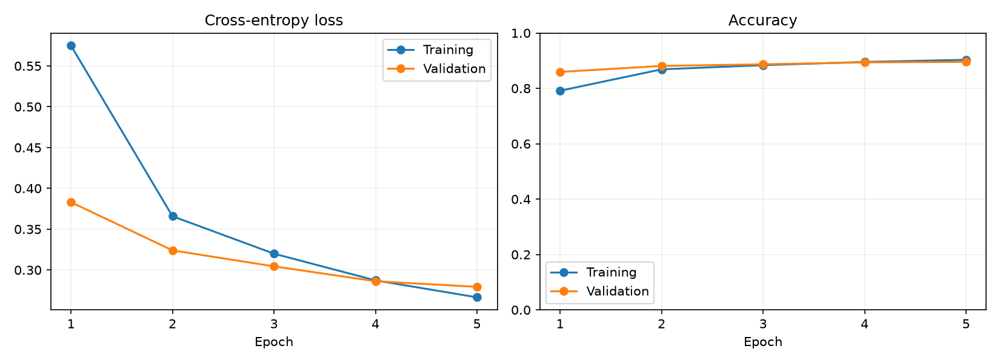

# 實驗成果與驗證紀錄

本資料夾收錄「**完整的動手指南：可在 Google Colab GPU 上訓練你的神經網路模型**」的實際證據。主要成果已由本機 RTX 4060 Laptop GPU 完成，設定、環境、逐輪紀錄、模型與圖表均保存在同一實驗資料夾。

## 已完成的實驗

| 實驗 | 測試 accuracy | 訓練與驗證時間 | 定位 |
| --- | ---: | ---: | --- |
| [RTX 4060 GPU 實驗](local_rtx4060/summary.md) | **89.40%** | 48.91 秒 | 本報告主要成果 |
| [先前 CPU 紀錄](local_cpu_demo/summary.md) | 89.57% | 51.97 秒 | 次要歷史參考 |

兩次均使用 54,000 張訓練、6,000 張驗證與 10,000 張測試資料，5 epochs、batch size 128、learning rate 0.001、seed 42。CPU 使用 `+cpu` 套件，GPU 使用 `+cu128` 套件，且各為單次觀察；不將時間差當成純硬體加速倍數，也不由分數差推論穩定的裝置優劣。Colab 為教學部署途徑，以上數字均來自本機。

## GPU 主要成果

最佳驗證模型位於第 5 輪，測試 loss 為 0.289209、Macro F1 為 0.894313。完整指標、四張成果圖與分析見 [GPU 實驗摘要](local_rtx4060/summary.md) 及 [報告正文](../docs/REPORT.md)。

## GPU 證據檔案

| 檔案 | 內容 |
| --- | --- |
| [summary.md](local_rtx4060/summary.md) | 實驗摘要與圖表分析 |
| [config.json](local_rtx4060/config.json) | 本次設定 |
| [environment.json](local_rtx4060/environment.json) | 軟體環境與實際裝置 |
| [gpu_hardware.json](local_rtx4060/gpu_hardware.json) | GPU、記憶體與驅動 |
| [gpu_runtime.json](local_rtx4060/gpu_runtime.json) | CUDA 運算確認、計時、PyTorch 記憶體統計 |
| [history.csv](local_rtx4060/history.csv) | 逐 epoch 紀錄 |
| [metrics.json](local_rtx4060/metrics.json) | 最終測試結果及每類指標 |
| [training.log](local_rtx4060/training.log) | 實際執行輸出 |
| [checkpoint_verification.json](local_rtx4060/checkpoint_verification.json) | 已訓練權重的 CPU／GPU 載入與推論檢查 |
| [best_model.pt](local_rtx4060/best_model.pt) | 可直接載入的已訓練模型，約 0.83 MB |
| [training_curves.png](local_rtx4060/training_curves.png) | 學習曲線 |
| [confusion_matrix.png](local_rtx4060/confusion_matrix.png) | 真實類別對預測類別 |
| [predictions.png](local_rtx4060/predictions.png) | 預測範例 |
| [misclassified.png](local_rtx4060/misclassified.png) | 實際分類錯誤 |

本次小型 GPU 權重已保留，可直接下載載入。再次執行時請使用新資料夾，程式會拒絕覆寫已有成果的輸出位置；紀錄方式見 [EXPERIMENTS.md](../docs/EXPERIMENTS.md)。

## 數字與圖片的使用規則

- 以同一輪的 `config.json`、`environment.json`、`history.csv` 與 `metrics.json` 配對解讀。
- 完整模式的切分張數應是 54,000／6,000／10,000；quick 模式是 2,048／512／512，訓練 1 個 epoch。
- `test_accuracy` 為 0～1 的比例；轉為百分比時乘以 100。
- `train_seconds` 依程式實際計時範圍解讀，不等於包含下載與手動操作的總耗時。
- 正式模型由驗證 loss 選擇，測試集用於選定模型的最終評估。
- 圖說寫明來自 CPU 或 GPU、完整模式或 quick 模式；未完成公平比較前，不宣稱 GPU 加速倍數。

Colab 硬體與資源供應會變動，請以每次執行環境為準；暫存機器結束後檔案可能消失，需主動保存。[Colab 官方資源與檔案說明](https://research.google.com/colaboratory/intl/en-GB/faq.html)
