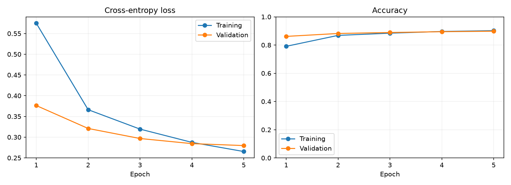
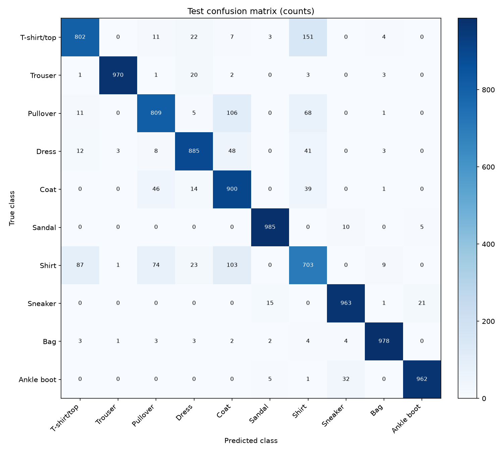
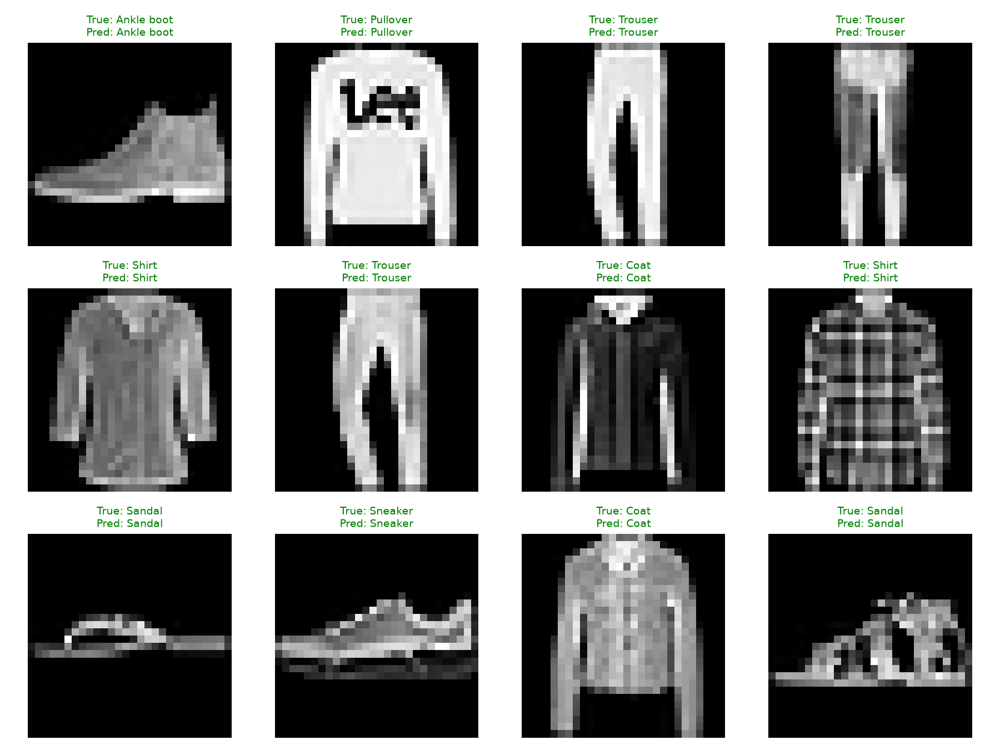
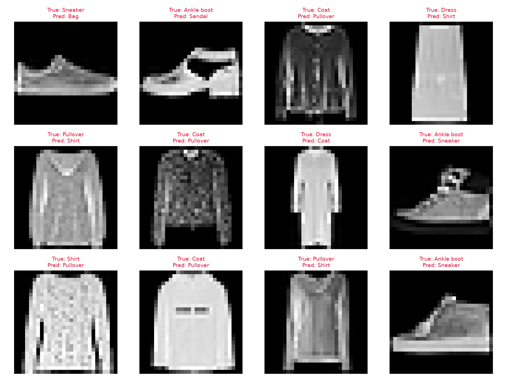

# 本機 CPU 完整訓練範例

這是本專案先前實際執行的 **CPU 結果**，保留作為流程驗證紀錄。報告的主要 GPU 實驗改以 [本機 RTX 4060 完整成果](../local_rtx4060/summary.md) 為準；此處數字仍屬 CPU 測量。

## 實驗與環境

| 項目 | 實際內容 |
| --- | --- |
| 日期 | 2026-10-29，Asia/Taipei |
| 裝置 | CPU，4 個 PyTorch 運算執行緒 |
| 系統 | Windows 11 |
| Python | 3.12.14 |
| PyTorch / torchvision | 2.9.1+cpu / 0.24.1+cpu |
| NumPy | 2.5.4 |
| 資料切分 | 54,000 訓練 / 6,000 驗證 / 10,000 測試 |
| epochs / batch size / learning rate | 5 / 128 / 0.001 |
| seed / quick_mode | 42 / false |

執行命令為 `python train.py --output-dir results/local_cpu_demo`，並將 `OMP_NUM_THREADS` 與 `MKL_NUM_THREADS` 設為 4。重做時請使用新的輸出資料夾；程式會拒絕將新實驗寫入已有檔案的資料夾。

## 實際結果

| 指標 | 數值 |
| --- | ---: |
| 最佳驗證 epoch | 5 |
| 最低驗證 loss | 0.279697 |
| 最終測試 loss | 0.284769 |
| 最終測試 accuracy | **89.57%** |
| Macro F1 | 0.896025 |
| 訓練與驗證計時 | 51.97 秒 |
| 可訓練參數 | 206,922 |

時間包含 `fit` 中各 epoch 的訓練、驗證與紀錄寫入，不包含資料下載、最終測試及圖表產生。單次 CPU 測量不能用來宣稱 GPU 加速倍數，也不能保證其他機器得到相同時間或分數。

設定與數字可由 [config.json](config.json)、[environment.json](environment.json)、[history.csv](history.csv) 與 [metrics.json](metrics.json) 核對。模型權重 `best_model.pt` 留在本機，但依 `.gitignore` 不預設提交到 GitHub；可依相同程式重新訓練產生。

## 圖表與觀察

訓練 loss 從 0.5748 降至 0.2653，驗證 loss 從 0.3763 降至 0.2797；本次五輪的最低驗證 loss 出現在第 5 輪。這段紀錄顯示模型有學習，但不能據此推論增加更多 epochs 一定持續改善。

各類別召回率中，Shirt 為 70.30%，低於本次多數類別；Trouser 為 97.00%、Sandal 為 98.50%。這些是本次輸出的觀察。服飾輪廓或低解析度可能影響分類，仍需配合錯例檢查，不能僅由類別名稱判定原因。

報告的主要實驗與分析請見 [RTX 4060 GPU 成果](../local_rtx4060/summary.md) 與 [完整報告](../../docs/REPORT.md)。兩次實驗使用不同的 PyTorch 套件版本後綴（CPU 與 CUDA），因此本專案保留原始紀錄，未據此宣稱 GPU 加速倍數。
